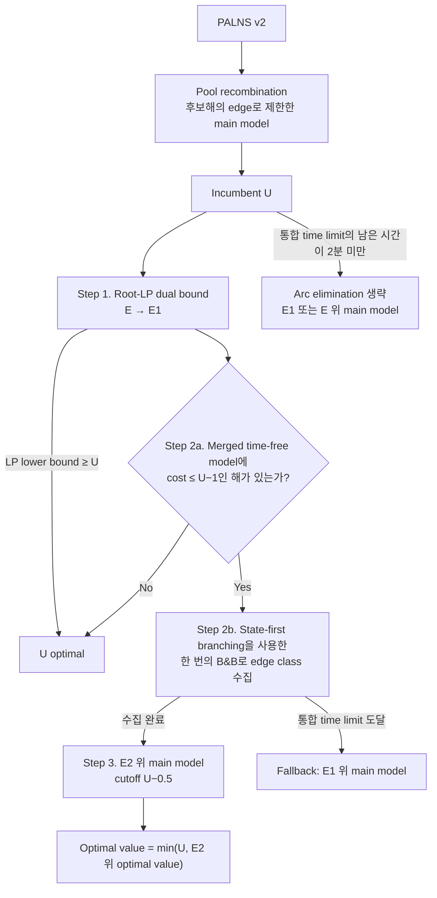

## 1. 전체 흐름

### 1.1 목적

State-expanded multigraph를 $G=(V,E)$라 하자. Edge $e\in E$의 선택변수는 $y_e$이고 original cost는 $c_e\in\mathbb Z_+$이다. `main model`의 feasible set을 $X(E)$로 쓴다. 현재 incumbent cost가 $U$이면 개선해의 존재 여부는

$$
y\in X(E),\qquad c(y)=\sum_{e\in E}c_ey_e\le U-1
\tag{1}
$$

의 feasibility로 판단할 수 있다. Arc elimination의 목적은 (1)을 만족하는 모든 해가 사용하는 edge를 포함하는 작은 집합 $E_2\subseteq E$를 구성하는 것이다. 이 조건이 만족되면

$$
z^*=\min\left\{U,\ \min_{y\in X(E_2)}c(y)\right\}
\tag{2}
$$

가 성립한다. 따라서 마지막에는 전체 graph가 아니라 $(V,E_2)$ 위에서만 `main model`을 풀면 된다.

### 1.2 최종 algorithm

`main model`은 VI44의 fleet-size lower bound, state-disaggregated time-flow formulation (TF2), capacity cut을 포함한다. 세 기법의 역할은 겹치지 않는다. arc elimination은 시간과 무관한 조합 탐색을 줄이고, TF2는 시간 제한 때문에 생기는 LP gap을, capacity cut은 시간과 무관한 LP gap을 줄인다. 실험 2, 3은 arc elimination을 넣은 뒤에도 뒤의 두 기법이 필요한지 본다.

## 2. 기본 arc elimination

### 2.1 Step 1: Root-LP dual bound

먼저 `main model`의 root LP를 푼다. LP의 dual vector로부터 lower bound $L$과 각 edge를 $y_e=1$로 고정했을 때의 추가 lower-bound contribution $d_e$를 계산한다. 다음 조건을 만족하는 edge는 cost $U-1$ 이하의 해에 포함될 수 없다.

$$
L+d_e>U-1.
\tag{3}
$$

$L+d_e$는 $y_e=1$로 고정한 LP의 valid lower bound이다. 따라서 (3)을 만족하는 edge는 어떤 improving integer solution에도 포함될 수 없다. 이 edge들을 제거하여 $E_1$을 만든다. $\lceil L\rceil\ge U$이면 현재 incumbent가 optimal이므로 이후 단계를 생략한다.

### 2.2 Step 2의 기본 model: time-free model

`Time-free model` $M^0(E_1)$은 `main model`에서 node-time constraint와 time-flow constraint를 제거한 model이다. 그 feasible set을 $X^0(E_1)$이라 하면

$$
X(E_1)\subseteq X^0(E_1).
\tag{4}
$$

$M^0$의 core는 다음과 같다. 여기서 $\bar V=V^p\cup V^d$이고 $\Sigma_v$는 node $v$에서 가능한 post-service state set이다.

$$
\begin{aligned}
\sum_{e\in\delta^-(v)}y_e&=1
&&\forall v\in\bar V,\\
\sum_{e\in\delta^+(v)}y_e&=1
&&\forall v\in\bar V,\\
\sum_{\substack{e\in\delta^-(v)\\\sigma_e^+=\sigma}}y_e
-\sum_{\substack{e\in\delta^+(v)\\\sigma_e^-=\sigma}}y_e&=0
&&\forall v\in\bar V,\ \sigma\in\Sigma_v,\\
\sum_{\substack{e:u_e=0\\v_e\in V^p}}y_e
-\sum_{\substack{e:u_e\in V^d\\v_e=0'}}y_e&=0,\\
y_e&\in\{0,1\}
&&\forall e\in E_1.
\end{aligned}
\tag{5}
$$

첫 두 constraint는 모든 action을 한 번씩 수행한다. 세 번째 constraint는 같은 post-service state를 갖는 incoming edge와 outgoing edge를 연결한다. 네 번째 constraint는 depot departure 수와 return 수를 일치시킨다.

Time constraint가 없으므로 (5)는 depot-to-depot path뿐 아니라 disconnected directed cycle도 허용한다. 따라서 $M^0$은 route-feasible model이 아니라 `main model`의 relaxation이다. Step 2에서는 이 넓은 feasible set을 이용하여 cost $U-1$ 이하의 main-model solution이 사용할 수 있는 edge를 수집한다.

### 2.3 Basic $E_2$ collection

$E_2$는 $E_1$에 남아 있는 incumbent edge들로 시작한다. 이후 다음 feasibility problem을 한 번의 B&B로 탐색한다.

$$
y\in X^0(E_1),\qquad
c(y)\le U-1,\qquad
\sum_{e\in E_1\setminus E_2}y_e\ge1.
\tag{6}
$$

Integer solution $\hat y$가 발견될 때마다 선택된 edge를 $E_2$에 추가한다.

$$
E_2\leftarrow E_2\cup\{e\in E_1:\hat y_e=1\}.
\tag{7}
$$

이후 (6)의 마지막 inequality를 갱신된 $E_2$에 맞추어 lazy constraint로 다시 추가한다. B&B를 반복해서 시작하지 않고 하나의 search tree 안에서 이 과정을 계속한다. 더 이상 (6)을 만족하는 solution이 없으면 collection이 완료된다.

이 절차가 계산적으로 유효한 이유는 13.3에서 분석했듯이 $M^0$의 optimal value가 `main model`의 optimal value에 가깝고, 앞선 heuristic이 high-quality incumbent $U$를 제공하기 때문이다. $L^0=\min\{c(y):y\in X^0(E_1)\}$이고 `main model`의 optimal value를 $z^*$라 하면 $L^0\le z^*\le U$이므로, (6)의 feasible integer solution은 $L^0\le c(y)\le U-1$인 좁은 objective window에 한정된다. 실제로 실험에서 $M^0$가 optimality까지 풀린 65개 instance 중 41개는 $L^0=z^*$였고 54개는 $z^*-L^0\le5$였다. 

**Proposition 1 (basic collection의 validity).** Step 2가 infeasibility로 종료되면, cost가 $U-1$ 이하인 모든 `main-model solution`은 $E_2$의 edge만 사용한다.

**Proof.** 반대로 $y\in X(E_1)$이고 $c(y)\le U-1$이면서 $E_2$ 밖의 edge를 사용한다고 하자. (4)에 의해 $y\in X^0(E_1)$이고 $\sum_{e\in E_1\setminus E_2}y_e\ge1$이므로 (6)을 만족한다. 이는 Step 2의 infeasibility와 모순이다. $\square$

### 2.4 Step 3: Restricted main model

Step 2가 완료되면 $(V,E_2)$ 위에서 원래 `main model`을 푼다. Cost가 integer이므로 solver cutoff는 $U-0.5$로 설정하여 $U-1$ 이하의 해만 탐색한다. 결과는 아래 3가지 경우로 나뉜다.

- Restricted model이 feasible이고 optimality까지 풀리면, 그 optimal solution이 전체 문제의 optimal solution이다.
- Restricted model이 infeasible이면, 기존 incumbent \(U\)가 optimal이다.
- Time limit에 도달하면, 발견된 해는 incumbent만 갱신하며 optimality는 아직 증명되지 않는다.

***Step 2가 time limit 안에 끝나지 않으면 validity가 확인되지 않은 $E_2$를 사용하지 않고 $E_1$ 위에서 `main model`을 푼다.**

## 3. 가속화 1: state-first branching

### 3.1 State 고정 시 assignment problem

각 action node $v$의 post-service state를 하나씩 고정한 state vector를

$$
\boldsymbol\sigma=(\sigma_v)_{v\in\bar V}
\tag{8}
$$

로 둔다. 이 state vector와 양립하는 edge set은

$$
E(\boldsymbol\sigma)=
\left\{
e\in E_1:
\sigma_e^-=\sigma_{u_e}\ \text{and}\
\sigma_e^+=\sigma_{v_e}
\right\}
\tag{9}
$$

로 둔다. Depot에 incident한 edge에서는 존재하는 service endpoint의 state만 검사한다.

**Proposition 2 (conditional assignment structure).** 모든 action node의 state를 고정하면, degree constraint, state-balance constraint, depot-balance constraint로 이루어진 time-free core는 $E(\boldsymbol\sigma)$ 위의 assignment problem이다. 그 LP relaxation은 integral이다.

**Proof.** State와 양립하지 않는 edge를 제거하면 각 node에는 고정된 state에 해당하는 edge만 남는다. 따라서 state-balance constraint는 in-degree $1$과 out-degree $1$의 차이이고 degree constraint에 의해 redundant하다.

남은 constraint matrix의 row를 각 service node의 incoming-degree row와 outgoing-degree row, 그리고 depot-balance row로 둔다. 모든 incoming-degree row에 $-1$을 곱하면 각 edge column은 정확히 하나의 $+1$과 하나의 $-1$을 갖는다.

- Internal edge $u\rightarrow v$: $u$의 outgoing row에 $+1$, $v$의 incoming row에 $-1$.
- Depot departure $0\rightarrow v$: depot row에 $+1$, $v$의 incoming row에 $-1$.
- Depot return $u\rightarrow0'$: $u$의 outgoing row에 $+1$, depot row에 $-1$.

따라서 이 matrix는 directed node-arc incidence matrix이고 totally unimodular이다. Right-hand side와 variable bound가 integer이므로 모든 extreme point가 integral하다. 즉, 고정된 $\boldsymbol\sigma$에 대한 minimum-cost problem은 LP로 풀리는 assignment problem이며, bipartite expansion에서는 min-cost flow와 같다. $\square$

### 3.2 Branching rule

Proposition 2를 이용하기 위해 node state가 edge보다 먼저 고정되도록 branching priority를 설정한다. Node $v$가 state $\sigma$로 방문되는지를 나타내는 state-selection variable을

$$
z_{v\sigma}
=
\sum_{\substack{e\in\delta^-(v)\\\sigma_e^+=\sigma}}y_e
=
\sum_{\substack{e\in\delta^+(v)\\\sigma_e^-=\sigma}}y_e
\tag{10}
$$

로 정의한다. Equality는 state-balance constraint에서 나오며 degree constraint에 의해

$$
\sum_{\sigma\in\Sigma_v}z_{v\sigma}=1
\qquad \forall v\in\bar V
\tag{11}
$$

이다. 따라서 integer solution에서는 각 node마다 정확히 하나의 state가 선택된다.

각 $z_{v\sigma}$를 나타내는 auxiliary state-selection variable을 만들고 edge variable보다 높은 `BranchPriority`를 부여한다. B&B는 edge의 세부 연결을 정하기 전에 node별 state를 먼저 고정한다. State vector가 고정될수록 남은 edge 선택은 Proposition 2의 assignment structure에 가까워진다. 이를 `state-first branching`이라 한다. 대표 5개 instance에서 basic time-free model의 edge-first search와 비교했을 때 arc-elimination time이 약 28% 감소하였다.

## 4. 가속화 2: merged time-free model

### 4.1 Request-group merging and merged variables

$M^0$에서 request label을 제외한 service attribute가 같은 action node들은 서로 교환 가능하다. 예를 들어 pickup action $v_1^p,v_2^p,v_3^p$가 동일한 recycling center에서 같은 skip type을 pickup하고 같은 treatment facility로 운반해야 한다면, request label만 서로 바꾸어 동일한 physical movement와 state transition을 나타내는 해가 반복해서 생성된다. meged model은 이러한 symmetry를 부순다.

Request $i$의 action node $v_i^\alpha$ ($\alpha\in\{p,d\}$)에 대해 $o_{v_i^\alpha}=\alpha$는 **operation type** (pickup or delivery), $r_{v_i^\alpha}=r_i$는 service가 수행되는 **recycling center**, $h_{v_i^\alpha}=h_i$는 **skip type**을 나타낸다. Treatment-facility attribute는 pickup에서만 필요하므로 $l_{v_i^p}=l_i$, $l_{v_i^d}=\bot$로 둔다.

이 attribute가 모두 같은 action node들을 하나의 `request group`으로 묶는다. Original node를 merged node로 보내는 mapping과 merged node set을

$$
M_V(v)
=
\bigl(o_v,r_v,h_v,l_v\bigr),
\qquad
V^M
=
\{M_V(v):v\in\bar V\}
\tag{12}
$$

로 둔다. Pickup과 delivery는 $o_v$가 다르므로 서로 merge되지 않는다. Delivery node에서는 $l_v=\bot$이므로 original request의 treatment facility가 달라도 나머지 attribute가 같으면 같은 group에 속한다. Merged node $q\in V^M$가 대표하는 original action node 수는

$$
n_q
=
|M_V^{-1}(q)|
$$

로 둔다. Virtual start node와 end node에 대해서는 $M_V(0)=0$과 $M_V(0')=0'$로 둔다.

Request group이 node-level aggregation을 정의한다면, merged variable을 만들기 위해서는 group 사이의 동일한 edge transition도 식별해야 한다. Original edge $e$의 tail과 head를 각각 $u_e$와 $v_e$라 하고, original edge를 merged edge로 보내는 mapping과 merged edge set을

$$
M_E(e)
=
\bigl(
M_V(u_e),M_V(v_e),
\sigma_e^-,\sigma_e^+,\pi_e
\bigr),
\qquad
E^M
=
\{M_E(e):e\in E_1\}
\tag{13}
$$

로 둔다. 여기서 $\sigma_e^-$와 $\sigma_e^+$는 tail과 head endpoint의 vehicle state이고, $\pi_e$는 edge 내부에 embedded된 treatment-facility sequence이다. 두 original edge의 $M_E(e)$가 같으면 request label을 제외한 movement과 state transition이 같으므로 하나의 merged edge로 묶인다.

Merged edge $a\in E^M$의 구성요소는 $(u_a,v_a,\sigma_a^-,\sigma_a^+,\pi_a)$로 표기한다. 여기서 $u_a$와 $v_a$는 merged tail node와 head node이다.

Merged edge $a\in E^M$가 대표하는 original edge들은 $M_E^{-1}(a)$이다. Merged variable은

$$
x_a\in\{0,1,\ldots,|M_E^{-1}(a)|\}
\tag{14}
$$

이며, 같은 움직임을 몇 번 사용하는지를 나타낸다. Objective coefficient는

$$
\bar c_a=\min_{e\in M_E^{-1}(a)}c_e
\tag{15}
$$

로 둔다. 동일 class의 cost가 모두 같으면 원래 cost와 일치하고, 다르더라도 minimum을 사용하므로 merged model은 relaxation이 된다.

Merged time-free model $\bar M^0$의 core constraint는 다음과 같다.

**Group degree**

$$
\sum_{\substack{a\in E^M\\v_a=q}}x_a=n_q,
\qquad
\sum_{\substack{a\in E^M\\u_a=q}}x_a=n_q
\qquad \forall q\in V^M.
\tag{16}
$$

**Group-state balance**

$$
\sum_{\substack{a\in E^M\\v_a=q\\\sigma_a^+=\sigma}}x_a
-
\sum_{\substack{a\in E^M\\u_a=q\\\sigma_a^-=\sigma}}x_a
=0
\qquad \forall q\in V^M,\ \sigma.
\tag{17}
$$

**Depot balance**

$$
\sum_{\substack{a\in E^M\\u_a=0}}x_a
=
\sum_{\substack{a\in E^M\\v_a=0'}}x_a.
\tag{18}
$$

Merged node $q$에서 state $\sigma$를 사용하는 original node 수는

$$
w_{q\sigma}
=
\sum_{\substack{a\in E^M\\v_a=q\\\sigma_a^+=\sigma}}x_a,
\qquad
w_{q\sigma}\in\{0,1,\ldots,n_q\}
\tag{19}
$$

로 둔다. $w_{q\sigma}$에 높은 `BranchPriority`를 부여하여 acceleration 1의 state-first branching을 group-count 형태로 유지한다.

`Main model`에서는 request별 action node가 time propagation과 route connectivity의 기준이 되므로 node를 merge하면 각 visit의 identity와 order를 구분할 수 없다. 반면 $M^0$은 time constraint와 SEC를 제외하고 degree, state balance, group multiplicity만 사용하며, 이 constraint들은 동일한 service attribute를 가진 request label을 서로 바꾸어도 변하지 않는다. 따라서 이러한 node를 group count로 merge해도 모든 original $M^0$ solution은 merged model에 보존된다. Merge로 extra solution이 추가될 수는 있지만 Step 2는 improving solution을 모두 포함하는 relaxation만 필요하므로 correctness에는 영향이 없다. 즉 merge model은  $M^0$의 relaxation이다 (LP, IP 모두).

### 4.2 Merge model이 $M^0$의 relaxation임을 증명.

**Proposition 3 (merge validity, 당연한 거이긴 함).** 모든 $y\in X^0(E_1)$에 대해 cost가 증가하지 않는 merged solution $(x,w)$가 존재한다. 특히 다음 implication이 성립한다.

$$
\exists y\in X^0(E_1):c(y)\le U-1
\quad\Longrightarrow\quad
\exists x\in\bar X^0(E_1):\bar c(x)\le U-1.
\tag{20}
$$

**Proof.** Original solution $y$에 대해

$$
x_a=\sum_{\substack{e\in E_1\\M_E(e)=a}}y_e,
\qquad
w_{q\sigma}=
\sum_{\substack{v\in\bar V\\M_V(v)=q}}
\sum_{\substack{e\in\delta^-(v)\\\sigma_e^+=\sigma}}y_e
\tag{21}
$$

로 정의한다. $y$가 binary이므로 $x_a$와 $w_{q\sigma}$는 integer이고 각각 (14), (19)의 bound를 만족한다.

Merged node $q$가 대표하는 $n_q$개 original node의 in-degree constraint와 out-degree constraint를 합하면 (16)을 얻는다. 같은 node들의 state-balance constraint를 state별로 합하면 (17)을 얻고, original depot-balance constraint는 (18)이 된다. Uniform coefficient를 갖는 valid inequality는 member edge를 합하여도 동일한 row가 되므로 유지된다.

Objective는 (15)에 의해

$$
\sum_{a\in E^M}\bar c_ax_a
=
\sum_{a\in E^M}\bar c_a
\sum_{\substack{e\in E_1\\M_E(e)=a}}y_e
\le
\sum_{e\in E_1}c_ey_e.
\tag{22}
$$

따라서 모든 original time-free solution은 cost가 증가하지 않는 merged solution으로 mapping된다. $\square$

식 (20)의 contrapositive는 다음과 같다.

$$
\nexists x\in\bar X^0(E_1):\bar c(x)\le U-1
\quad\Longrightarrow\quad
\nexists y\in X^0(E_1):c(y)\le U-1.
\tag{23}
$$

따라서 merged model의 infeasibility는 original time-free model의 infeasibility를 증명한다.

---
### 4.3 Merged solution으로부터 edge class 수집

Original solution에서 $y_e=1$이면 $a=M_E(e)$에 대해 (21)은 $x_a=\sum_{f:\,M_E(f)=a}y_f\ge y_e=1$을 의미한다. 즉, merge 후에는 어느 request label의 edge $e$가 사용되었는지는 알 수 없지만, $e$가 속한 merged edge $a$가 사용되었다는 사실은 $x_a>0$으로 보존된다. 따라서 $a$를 수집할 때 $M_E^{-1}(a)$의 original edge를 모두 $E_2$에 넣으면, 특정 request label을 식별하지 못해도 original solution이 사용한 edge를 누락하지 않는다.

이후 collection은 Section 2.3과 동일하다. Cost $U-1$ 이하의 merged solution이 발견될 때마다 $x_a>0$인 merged edge를 수집하고, lazy constraint로 아직 수집되지 않은 merged edge를 하나 이상 사용하도록 한다. 더 이상 그러한 solution이 없으면 collection이 완료된다.

## 5. 최종 선택과 computational evidence

최종 Step 2는 `merged time-free model + state-first branching`을 사용한다.

| 방법 | 구조 | 관찰된 효과 |
|---|---|---:|
| Basic time-free model | Original request별 edge variable | 기준 |
| State-first branching | Node state를 edge보다 먼저 branch | 대표 5개에서 arc-elimination time 약 28% 감소 |
| Merged time-free model | Identical request를 group-count로 aggregate | 대표 6개에서 1,009초 $\rightarrow$ 329초; state-first model 대비 약 67% 감소 |

전체 67개 instance에서 PALNS v2, pool recombination, arc elimination을 결합한 설정은 다음 결과를 보였다.

| 지표                              | Arc elimination 없음 | Arc elimination 사용 |
| ------------------------------- | -----------------: | -----------------: |
| Optimality proof                |                 60 |                 61 |
| 전체 runtime 합                    |            45,166초 |            28,032초 |
| 공통 62개 main solve 합             |            22,972초 |             5,777초 |
| Step 3에 도달한 26개의 $E_2/E$ median |                 -- |               6.2% |
