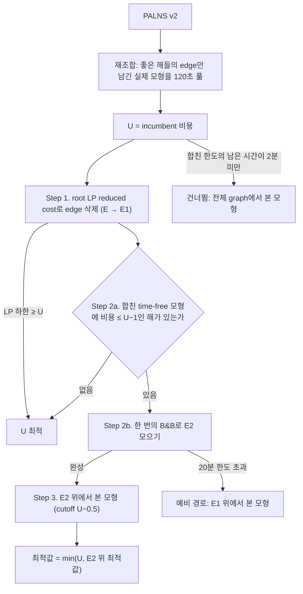

# SPDP
## 1. Pool recombination와 arc elimination 알고리즘

### 1.1 전체 흐름

- 본 모형: two-index multigraph 모형, fleet size 하한 (VI44 $k_{\min}$), strengthened duration constraint (TF2), capacity cut.
- 세 기법의 역할은 겹치지 않는다. arc elimination은 시간과 무관한 조합 탐색을 줄이고, TF2는 시간 제한 때문에 생기는 LP gap을, capacity cut은 시간과 무관한 LP gap을 줄인다. 실험 2, 3은 arc elimination을 넣은 뒤에도 뒤의 두 기법이 필요한지 본다.

### 1.2 Pool recombination

1. Phase II에서 나온 feasible 후보 해를 block으로 자른다. block은 route에서 차량이 빈 상태로 pickup을 시작해 다시 빈 상태가 될 때까지의 구간이다. block마다 "그 block을 가진 해 중 가장 싼 비용" $c(b)$를 메모리에 기록한다.
2. $c(b)\le U_{\text{PALNS}}+\delta$ ($\delta=3$)인 block이 쓰는 해의 edge들과 빈 차 이동 edge만 남긴다.
3. 이 부분 graph 위의 실제 모형 (two-index, TF2)을 PALNS 해에서 출발해 120초 푼다. 더 좋은 해가 나오면 그 해를 incumbent로 쓴다.

- 근거 (이전 분석 인스턴스): PALNS 해와 best-known 해는 같은 route가 하나도 없지만, 움직임 (edge)은 43–92%가 같다. PALNS가 놓치는 것은 route 2–3개 이상에 걸친 동시 재구성이고, 좋은 해들의 edge를 모아 MIP로 풀면 이것을 찾을 수 있다.

**PALNS 단계만 비교한 결과 (67개)**

| | v1 | v2 + 재조합 |
|---|---:|---:|
| v1보다 좋음 / 같음 / 나쁨 | – | 37 / 30 / 0 |
| U = time-free 하한 (최적 확인) | 19 | 35 |
| $\sum(U-\text{best known})$ | 604 | 97 |
| 시간 합 (초) | 13,725 | 10,789 (PALNS 8,980 + 재조합 1,809) |

- 재조합이 값을 낮춘 인스턴스는 12개다 (B7, B14, B16, B18, B19, C14, C16, C17, D3, D5, D6, D7).
- 시간은 큰 인스턴스 (C, D)에서 줄고 작은 인스턴스 (A, B)에서 살짝 늘었다.

### 1.3 Arc elimination

- 비용 $\le U-1$인 해가 쓰는 edge를 모두 포함하는 $E_2$를 구성하고, 본 모형은 $E_2$ 위에서만 풀이
$$
z^\ast=\min\Bigl\{U,\ \min_{x\in X(E_2)}c(x)\Bigr\}
$$

**Step 1. LP reduced cost 삭제 ($E\to E_1$)**
- capacity cut을 포함한 root LP 기준으로 $z_{LP}+d_e>U-1$인 edge 삭제
- $\lceil z_{LP}\rceil\ge U$이면 U 최적 

**Step 2. Time-free 모형으로 $E_2$ 수집 ($E_1\to E_2$)**
- $M0$: 시간 변수와 시간 제약을 뺀 모형. 원래 문제의 완화 ($X\subseteq X^0$)
- 아래 문제를 B&B 한 번으로 풀이 (by Gurobi)
$$
x\in X^0(E_1),\qquad c(x)\le U-1,\qquad \sum_{e\in E_1\setminus E_2}y_e\ge 1
$$
- 정수해가 나올 때마다 그 해의 edge class를 $E_2$에 추가하고, 마지막 제약을 lazy constraint로 갱신
- infeasible이면 $E_2$ 완성. 첫 해부터 없으면 U 최적

**Step 2 가속: 상태 고정 assignment에서 합친 모형까지**
- 출발점: $M0$에서 고객마다 방문 직후의 차량 상태 $\sigma_v$를 고정하면 assignment 문제 $AP(\sigma)$ -> LP로 정수해 가짐
-  $M0$의 어려움은 상태 벡터 $\sigma$ 선택 (고객당 상태 12–17개)
- 가속 아이디어 1. 상태 먼저 분기 (`branch=1`)
  - edge를 고르기 전에 "고객 $v$를 어떤 상태로 방문할지"부터 분기
  - 대표 5개에서 arc elimination 시간 −28%
- 가속 아이디어 2. 합친 모형 (최종 사용)
  - 같은 장소·같은 type의 요청 (예: p1, p2, p3)은 서로 바꿔도 같은 해 → B&B가 이름만 다른 해를 반복 탐색
  - 이런 고객을 묶음 하나로 보고, edge는 "이 묶음으로 가는 움직임을 몇 번 쓰나", 상태는 "묶음 중 몇 명이 상태 $s$인가"로 둠
  - 원래 $M0$의 완화이므로 "U보다 싼 해 없음" 증명은 그대로 유효
  - 대표 6개에서 arc elimination 시간 1,009초 → 329초 (아이디어 1만 쓴 판 대비 −67%)

**Step 3. $E_2$ 위 본 모형**
- $(V,E_2)$에서 cutoff $U-0.5$로 풀이. 해가 없으면 U 최적, 해가 나오면 그 해가 최적

**시간 한도** (PALNS + 재조합 + Step 1–2 합계 20분)
- PALNS 뒤 남은 시간 2분 미만: arc elimination 생략, $E_1$ 위에서 main model solving (C18, C20)
- $E_2$ 수집 미완료: $E_1$ 위에서 main model solving (C15, C16, C17, C19)

## 2. 실험 1. Arc elimination 유무

**설정**
- 67개, 인스턴스 한도 3,600초, Gurobi 8 thread, 한 번에 하나씩. 모든 실행에 VI44 $k_{\min}$ 포함
- 옛: PALNS v1, AE 없음 / v2: PALNS v2 + 재조합, AE 없음 / AE: PALNS v2 + 재조합 + AE
- 본 풀이: PALNS + 재조합 이후의 시간 (AE + 본 모형)

| | 옛 | v2 | AE |
|---|---:|---:|---:|
| 증명 (67개) | 59 | 60 | **61** |
| 시간 합 (초) | 45,889 | 45,166 | **28,032** |
| 본 풀이 합, 62개 (셋 다 미증명인 5개 제외) | 22,614 | 22,972 | **5,777** |

**결과**
- **시간 감소는 대부분 AE에서 발생**: 62개 본 풀이 −75%. AE가 v2보다 빠름 41 / 비슷 23 / 느림 3
- v2 + 재조합: U 개선 (37개), 본 풀이 시간 합은 옛과 비슷
- **새로 증명: C12, D5. 
- **AE 추가시 미 증명**: C17 ($E_2$ 수집 미완 → $E_1$ 위에서 main model solving해서 시간만 부족해짐)**
- **Step 3까지 간 26개의 $E_2$: 원래 edge의 중앙값 6.2%**
- 한계: U와 time-free 하한의 차이가 큰 C15–C20은 20분 안에 $E_2$ 수집 불가

## 3. 실험 2. Capacity cut 유무

**설정**
- 실험 1의 AE에서 capacity cut만 끔 (root LP 삭제, $E_2$ 위 본 모형, 예비 경로 모두)

| | 켬 | 끔 |
|---|---:|---:|
| 증명 | 61 | 61 |
| 시간 합 (초) | 28,032 | 27,957 |
| Step 3 본 모형 합, 26개 (초) | 1,123 | 1,227 |
| 미증명 6개의 (값 − 하한) 합 | 321 | 343 |

**결과**
- AE 모형에서 capacity cut 효과 거의 없음 (증명값 동일, 시간 −0.3%)
- **전체 graph의 root LP는 여전히 상승: root gap의 중앙값 34% 감소**
- $E_2$ 위 본 모형: Gurobi root cut 뒤 하한은 켬과 끔이 같음 (차이 중앙값 0.0)
- 효과가 남는 곳
  - **$E_2$가 큰 일부 인스턴스의 시간 (끄면 D6 +161초, C14 +36초, C4 +34초)**
  - **전체 graph를 푸는 미증명 인스턴스의 하한 (C18 +12, C20 +23)**
  - **AE에거 RC 기반 arc elimination에서 더 많은 arc 제거**
- **이유: 61개 중 35개는 본 모형을 풀지 않고, 나머지도 $E_2$가 작아 대부분 수 초 안에 끝남**

## 4. 실험 3. Strengthened duration constraint (TF2) 유무

**설정**
- 실험 2의 "끔"에서 TF2를 node-time Big-M 시간 제약으로 교체 (AE 포함)
- A1–A20만 실행

| | TF2 | Big-M |
|---|---:|---:|
| 증명 (20개) | 20 | **17** |
| 시간 합 (초) | 877 | **14,195** |

Step 3 ($E_2$ 위 본 모형)에서 차이가 난 4개:

| 인스턴스 | $E_2$ edge | 시간 TF2 (초) | 시간 Big-M (초) | root gap TF2 | root gap Big-M |
|---|---:|---:|---:|---:|---:|
| A8 | 827 | 0.4 | 2,613 | 3.0 | 13.0 |
| A9 | 461 | 0.0 | 한도 | 0.5 | 1.0 |
| A13 | 3,780 | 17.1 | 한도 | 1.3 | 7.0 |
| A15 | 3,389 | 1.1 | 한도 | 0.5 | 6.5 |

- root gap: U − (Gurobi root cut 뒤 하한). 비용이 정수라 1 미만이면 root에서 바로 증명
- 한도: 인스턴스 1시간 한도에서 미증명

**결과**
- TF2 효과는 AE를 넣어도 유지.

**세 실험 정리**
- AE: 시간 감소의 대부분 (증명 61, 62개 본 풀이 −75%)
- capacity cut: AE 모형에서 효과 거의 없음 (전체 graph를 푸는 미증명 인스턴스의 하한만)
- TF2: 필수 (빼면 A 묶음 증명 20 → 17, 시간 16배

# SCOP

## 1. 연구 방향과 공급 형평성

- 수요 불확실성 하에서 공급 형평성을 고려하는 covering routing problem (CRP)을 robust optimization (RO)으로 모형화하는 방향을 검토한다.
- 푸드뱅크 같은 비영리 서비스에서는 고객 간 형평성이 중요하다. 고객별 공급량 편차를 형평성 지표 후보로 두고, CRP에 어떻게 반영할지 검토한다.
- Tricoire 등의 2단계 모형을 참고한다. 형평성까지 고려할 경우, 2단계에서 방문 시 가능한 최대량을 공급하는 정책이 여전히 최적인지 검토한다. [Tricoire et al.](https://pmc.ncbi.nlm.nih.gov/articles/PMC3587456/)

## 2. 수요 단위와 서비스 거점

- 수요의 기본 단위는 마을(village)로 검토한다. 기존 CRP에서 다루는 수준이며, 개별 가구 단위로 모형화하면 문제가 지나치게 세분화된다.
- 도심(urban)과 교외(suburban)에서 village를 어떻게 정의할지 검토한다. 서비스 목적을 고려해 교외를 우선 검토한다.
- 차량이 방문하는 서비스 거점(Steiner node)의 후보로 교회, 주차장 등을 고려한다. 어떤 거점이 어느 village를 커버할지 정의하고, 거점 선정에 network design 요소를 포함할지 검토한다.

## 3. 수요 관측 시점과 의사결정

Steiner node를 선택하고 차량 경로를 배정하는 시점에는 각 거점을 방문할 고객의 수요를 정확히 알 수 없다.

- **서비스 직전에 수요를 아는 경우**에는 1단계에서 거점과 경로를 결정하고, 2단계에서 관측된 수요를 바탕으로 거점별 공급량을 재배분하는 two-stage 모형을 검토한다.
- **각 거점에 도착해야 수요를 아는 경우**에는 방문할 때마다 관측한 수요에 맞춰 배분하는 multi-stage 모형을 검토한다. 단순화한 two-stage 모형에서는 1단계에서 정한 공급량을 2단계에서 실제 수요에 비추어 평가한다.

## 4. 수요 불확실성 집합과 배분 하위문제

- Alkaabneh 등의 푸드뱅크 연구는 수요 지점별 Gamma 분포의 shape와 scale을 제공한다. 이 모수를 본 문제의 수요 설정에 활용할 수 있을지 검토한다. [Alkaabneh et al., Appendix B](https://optimization-online.org/wp-content/uploads/2022/07/MFPP_Main.pdf)
- 노드별 기준 수요와 최대 편차를 정의하고, 불확실성 예산을 둔 budgeted RO로 수요를 모형화하는 방안을 검토한다.
- 식품 배분량을 연속변수로 두고, 배분 하위문제를 선형계획(LP)으로 정식화할 수 있는지 검토한다.

## 5. 데이터 생성 절차

1. 운영 단위를 정한다.
2. Village와 Steiner node 후보를 정의하고, 그래프와 커버 관계를 설정한다.
3. Village별 수요 범위를 정한다.
4. 도로망 기반 이동시간 및 이동비용 행렬을 구성한다.
5. Village, Steiner node, 차량의 모형 파라미터를 정한다.

# 미팅 내용 정리

- SPDP는 arc elimination까지 적용
- capacity cut은 AE 없을 때 효과적임을 잘 description
- SCOP는 Alkaabneh의 통계량기반 data 생성과 data를 받아와서 생성. 또는 그냥 현실 데이터 있는지 탐색해서 graph data와 수요 분포 또는 uncertainty bound 데이터 생성 후 RO modeling까지 해보기 --> 이후 chun cheng에 컨택